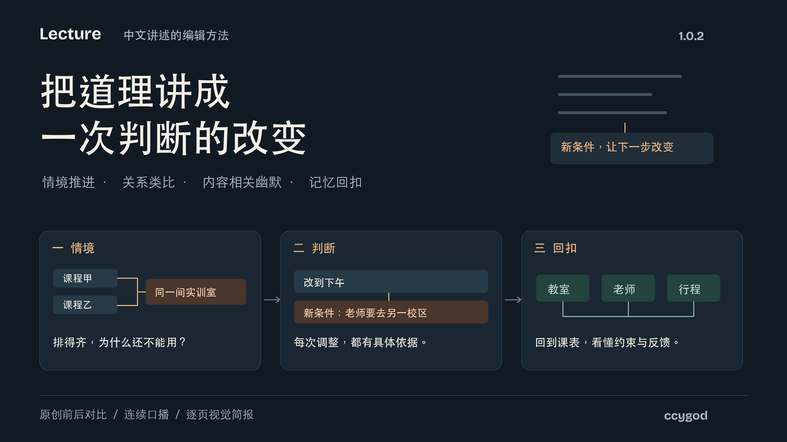

# Lecture：把想讲的道理，变成听众跟得上的一段话

**从具体困境讲起，让判断发生变化，让关键关系留下来。**



[先看四组前后对比](examples/editorial-before-after.md) · [看口播怎样变成页面](examples/spoken-to-slide.md) · [安装使用](#安装与开始) · [发布版本](https://github.com/ccygod/lecture/releases)

你可能已经有了大纲，也知道自己想讲什么。真正费力的地方在后面：一个观点怎样讲出中间过程？一个类比怎样帮人理解？一处幽默怎样长在内容里？讲完以后，听众到底带走哪一个判断？

Lecture是一套面向中文授课、客户和领导汇报、公开演讲与合作发言的智能体技能。它把这些问题放进同一条编辑流程：**保住讲者的主张，写顺连续口播，用情境、反差、类比和回扣推进理解，再把关键关系交给页面。**

## 先感受一下，它在改什么

以下均为原创虚构的编辑示例，数字与情境用于说明方法。

### 让事情走下去，判断才有理由改变

**改写前：**“安排任务时，应兼顾资源约束，提高计划的可执行性。”

**改写后：**

> 设想你要排一场培训：课程齐了，老师齐了，每门课也都填了时间。你把表发出去，才发现两门课都要用同一间实训室。我们先把其中一门挪到下午，问题解决了吗？还没有，那位老师下午要去另一校区。继续改，直到教室、老师和路上的时间一起对得上。到这里，才算排出了一张能用的表。
>
> 我更看重的，是这张表明天能不能执行。排得整齐很容易让人放心，约束对上才让人真正放心。

这里改变了一个判断：“项目齐全”还不足以说明计划可执行。案例多走了两步，让教室冲突、应对和新条件推动结论；结尾保留讲者的取舍。

### 类比要能解释新条件下会发生什么

**改写前：**“智能体具备规划、执行和反馈能力，类似一个项目负责人。”

**改写后：**

> 先借导航看一组关系。你给它一个目的地，它给出路线；路走到一半，前面封了，它要根据新路况重新选路。目的地没变，下一步变了。讲智能体时，可以借这个关系理解：给定目标，调用可用工具，观察结果，再选择下一步。这一圈叫反馈闭环。类比就借到这里，导航的地图条件、智能体的工具权限和判断能力还要分别检查。

“像负责人”只给了角色名。封路以后为什么改路，才把目标、反馈和下一步之间的关系讲出来，最后回到正式术语。

### 内容本身，也可以长出一句轻松的话

**改写前：**“学习者应加强主动回忆，避免被动阅读造成的掌握错觉。”

**改写后：**

> 设想你看完一道题，解题过程每一步都懂。把答案盖住，再从头做一遍，笔停住了。刚才的顺畅，可能有一部分是答案替你走的。答案在的时候，你负责点头；答案一收，你还得负责下一步。现在换一个条件再做，看看自己能不能说出为什么这样选。

轻松处来自“点头”和“独立走下一步”的任务差别，后面紧接具体检验。普通解释也一起改成能说出口的话。[四组完整对比及编辑拆解 →](examples/editorial-before-after.md)

## 数字讲出量感，还要回答听众的“所以呢”

假设同样一批180份材料，初次归类由180分钟降到120分钟。只念“提升50%”，听众很难判断变化，更容易混淆时间与速度。

可以这样讲：

> 这组假设里，初次归类少用了60分钟，相当于从三个小时变成两个小时。用时减少约三分之一；如果只算每小时处理量，则是原来的1.5倍。这60分钟能怎么用？对下周要交方案的项目负责人，这60分钟可以留给方案讨论：把原本来不及展开的备选方向，先画两张流程草图，和同事比较各自解决了什么问题。下轮把归类和必要复核一起计时，再决定能稳定留出多少讨论时间。

**量感**让数字有参照；**口径**分清用时和处理速度；**价值桥接**把变化接到受众的期限、判断和下一步。不能从这组局部假设直接推出整个项目效率提高。[完整示例与计算依据 →](examples/editorial-before-after.md#第四组从局部数字走到受众可做的选择)

## 口播、上屏与视觉，分别做什么

口播讲出过程，上屏保留关键主张，画面把关系摆到眼前。以刚才的排课案例为例：

| 层次 | 实际内容 |
| --- | --- |
| 可念口播 | 两门课撞上同一间实训室；改到下午后，又遇到老师跨校区的问题；继续调整到约束一致。 |
| 逐字上屏 | “教室、老师、路上的时间，要一起对上”；三栏标题“原安排 / 第一次调整 / 可执行安排”。 |
| 视觉论证 | 三栏排期中保留同样两门课，只高亮每次变化的条件；冲突位置用描边和文字共同标出，最终栏显示约束同时成立。 |
| 认知动作 | 听众能指出第一次调整仍未解决哪个约束，说明为何还要再改。 |

制作者还能拿到阅读顺序、讲者指向、切换条件、制作模式与误读验收。一个主题需要几页，取决于观众要完成几个认知动作。[完整的口播→逐字文案→逐页视觉简报 →](examples/spoken-to-slide.md)

## 局部讲活了，整场还要讲顺

开头用排期问题建立“整齐”和“可执行”的差别，中段借导航解释反馈，最后回到那张课表：现在你能说清每次修改依据哪个新条件。**回扣让旧细节多承担一层理解。** 普通解释之间留出空间，不给每节硬塞反转、笑话或金句。

讲者本来要讨论“减少起步成本后，核验能力为何更重要”，改稿就需要保留这个关系和中间过程。事实需要修正时说明修正了什么，不把鲜明观点磨成空泛的“机遇与挑战并存”。[主张、整场节奏与回扣示例 →](examples/editorial-before-after.md#让四段组成一场讲述)

## 借鉴的是编辑动作

当前机制库有**8张卡**，按当前段落需要检索：判断转为取舍、规则延伸后的后果、具体结果的轻反差、细节回扣、选择—行动—结果、有铺垫的收束、把指标放回使用过程、用关系解释因果。

罗永浩、雷军、王自如、混子曰分别提供具体问题与判断变化、选择和叙事、体验比较、关系解释等编辑借鉴。库内保留来源定位和迁移边界；使用时原创写作，不复制标志台词、经历或身份。这些人物没有为项目背书，机制卡也不是他们风格的完整定义。[机制与原文依据 →](references/editor-workflow.md)

## 好内容，也需要能追溯的交接

- **先确认用途，再写稿。** 授课、汇报、公开发言采用不同结构；已有答复沿用，诊断真实大纲后再补关键缺口。
- **重要主张有去向。** 将原文主张对到真实口播和页面，记录必要的修正及记忆落点。
- **改稿后重审受影响的位置。** 候选选择和情境评审绑定实际文本版本；旧版的好评不能直接给新版盖章。
- **页面重排后重新算引用。** 用稳定ID引用页面，再按最终顺序编译页码，避免扩页后口播还指向旧页。
- **数据先核对，再计算。** 区分事实、预测、估算和假设；脚本处理数值，编辑检查参照与推理。

[稳定页码与版本回执的可运行体验 →](examples/traceable-handoff.md)

## 安装与开始

```bash
git clone https://github.com/ccygod/lecture.git
cd lecture
python3 -m pip install -r requirements.txt
python3 scripts/install_skill.py --host codex
```

Claude Code使用 `--host claude`；其他宿主使用 `--dest /你的技能目录/lecture`。安装器遇到已有目录会停止，保留已有修改。[兼容性说明](docs/compatibility.md)

安装后可以这样说：

```text
用 $lecture 处理这份20分钟的客户汇报大纲。
听众：高校领导团队。
目标：解释试点怎样解决当前问题，说明需要共同决定的下一步。
交付：连续中文口播和逐页PPT制作说明。
页面：原生可编辑图文。
语气：专业、自然、克制，保留我对验收标准的主张。
[粘贴大纲、关键依据与场合条件]
```

只要口播时可以只交连续稿；要完整配套时，交付口播及映射、逐页制作说明和适合用途的框架。技能会先核对用途、交付物、页面方式和场合条件。

## 验证与能力边界

仓库提供技能、参考方法和检查脚本；模型、联网、图像和PPT制作能力由宿主提供。此版本展示原创编辑示例与页面简报，没有替用户生成一套PPT。

脚本检查结构、引用、文本版本和数量计算；语义保真、讲述分寸、幽默和页面表达仍需编辑审查。184项回归测试通过不等于现场效果得到验证；示例未做真人试讲、听众实验或模型性能对照。引用研究支持局部设计思路，不能据此宣称整个技能具有已验证的科学效果。

```bash
python3 -m unittest discover -s scripts -p 'test_*.py' -v
python3 scripts/compare_quantities.py examples/quantity-reference.json
```

[实际验证记录](docs/validation.md) · [全部示例](examples/README.md) · [来源与权利说明](NOTICE.md) · [研究边界](references/oral-research.md)

作者：[ccygod](https://github.com/ccygod) · [贡献指南](CONTRIBUTING.md) · [帮助](SUPPORT.md) · [中文发布素材](docs/launch-kit.md) · [许可证](LICENSE)
